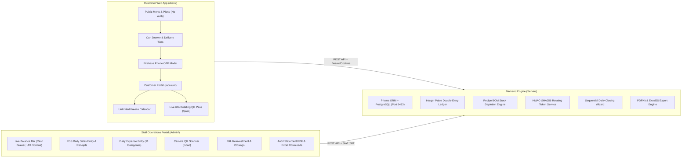

# 🌊 Nutrients Ocean — Production Ecosystem

Production-grade fitness nutrition ecosystem engineered for **Nutrients Ocean** in Mangalore, Karnataka. Built with strict clean architecture and zero floating-point financial drift across three isolated components.

---

## 🏗️ Architecture Overview



---

## 📁 Monorepo Structure

```
Nutrients Ocean/
├── client/          # Customer Storefront (Next.js 16, React 19, Turbopack)
│   ├── app/         # App Router: /, /menu, /account, /pass, /refund, etc.
│   ├── components/  # Navbar, CartDrawer, AuthModal, MenuExplorer, MenuSubscriptions
│   ├── context/     # CustomerAuthContext, CartContext
│   └── lib/         # api.js client fetch wrapper
│
├── Admin/           # Staff Operations Portal (React 18, Vite 5, Tailwind CSS)
│   ├── src/
│   │   ├── components/ # LiveBalanceBar, Staff Navbar, Camera QR Scanner
│   │   ├── pages/      # 11 Operational Modules (Dashboard, POS, OpEx, etc.)
│   │   └── api/        # axios staff API client with JWT interceptor
│   └── dist/           # Pre-compiled production build assets
│
└── Server/          # Authoritative Backend (Node.js, Express, Prisma, PostgreSQL)
    ├── prisma/      # schema.prisma (23 models) & seed.js
    ├── src/
    │   ├── controllers/ # Catalog, Orders, Subscriptions, Sales, Expenses, etc.
    │   ├── services/    # Double-entry ledger, Recipe BOM, QR HMAC, Closings
    │   ├── middlewares/ # Staff JWT auth, Customer auth, Error handling
    │   └── config/      # Database & Environment validation
    └── tests/       # Automated Phase 1 - 7 verification test suites
```

---

## 🚀 Quick Start Guide

### 1. Database (Neon Cloud PostgreSQL)
The database is hosted on **Neon Serverless PostgreSQL** (requires zero local laptop disk storage).
Your `DATABASE_URL` and `DIRECT_URL` connection strings are configured in `Server/.env`.

### 2. Backend Server (`Server/`)
```powershell
cd "d:\Nutrients Ocean\Server"
npm start
# Server listens on http://localhost:5000/api/v1
```

### 3. Staff Admin Portal (`Admin/`)
```powershell
cd "d:\Nutrients Ocean\Admin"
npm run dev
# Portal opens at http://localhost:5173
```
*Staff Credentials:*
- **Email:** `owner@nutrientsocean.com`
- **Password:** `Admin@Nutrients2026`

### 4. Customer Storefront (`client/`)
```powershell
cd "d:\Nutrients Ocean\client"
npm run dev
# Customer web app opens at http://localhost:3000
```

---

## 🎯 Key Features & Rules Enforced

1. **Zero Auth Barrier for Browsing:**
   - Visitors can freely browse the full stall menu, ingredients, macro breakdowns, and monthly plans without sign-in popups.
   - On-demand Firebase Phone OTP triggers only upon checkout, subscription join, or opening `/account` / `/pass`.
   - In dev/testing, click *"One-Tap Dev Login (+91 98765 43210)"* for instant authentication.

2. **30-Day Monthly Subscriptions & Unlimited Freeze Calendar:**
   - Exactly **30 servings** per subscription (1 serving per active day).
   - **Unlimited Freezes:** Members can freeze/skip any day from `/account`.
   - Frozen days are **never lost** — valid servings remain intact until all 30 are enjoyed.

3. **Option 1 60-Second Rotating QR Pass (`/pass`):**
   - High-contrast screen optimized for stall counter scanning.
   - Live HMAC-SHA256 signature refreshes automatically every 60 seconds with an animated countdown ring.
   - Anti-screenshot protection: Stale or forwarded screenshots (>60s old) are automatically rejected (`EXPIRED_QR`).
   - Same-day duplicate redemptions are strictly rejected (`ALREADY_REDEEMED`).
   - Frozen-day scanning rejected with one-click unfreeze button on customer's pass.

4. **Double-Entry Financial Ledger (Integer Paise Precision):**
   - Zero floating-point math anywhere in financial operations.
   - Live multi-account balance bar tracks:
     - 💵 **Counter Cash Drawer** (`PHYSICAL_CASH`)
     - 📱 **UPI / Online** (`UPI_DIGITAL`)
   - Sequential Daily Closing Wizard reconciles expected physical cash till against actual cash count.

5. **Automatic Recipe BOM Inventory Depletion:**
   - Walk-in POS sales and stall QR pass collections automatically consume raw ingredients (oats, milk, peanut butter, bananas, dry fruits, honey, seeds) in real-time according to their Bill of Materials formulation.

6. **Server-Side Verified PDF & Excel Exports:**
   - Generates binary `%PDF` P&L audit statements.
   - Generates binary `PK` `.xlsx` spreadsheets for Sales, Expenses, Inventory, and Subscriptions.

---

## 🧪 Test Verification Suite

All 7 phases have dedicated, automated test suites in `Server/tests/`:

| Phase | Test Suite | Scope | Status |
| :--- | :--- | :--- | :--- |
| **Phase 1** | `node tests/phase1-verify.js` | Schema, 23 models, anti-tamper triggers & seed | ✅ 19/19 Passed (100%) |
| **Phase 2** | `node tests/phase2-verify.js` | Cash ledger, POS, expenses, closings & investments | ✅ 28/28 Passed (100%) |
| **Phase 3** | `node tests/phase3-verify.js` | Customer auth, orders, subscriptions & 60s QR | ✅ 41/41 Passed (100%) |
| **Phase 4** | `node tests/phase4-verify.js` | Financial analytics, PDFKit & ExcelJS engines | ✅ 39/39 Passed (100%) |
| **Phase 5** | `node tests/phase5-verify.js` | Admin React 11 modules & Vite build | ✅ 14/14 Passed (100%) |
| **Phase 6** | `node tests/phase6-verify.js` | Client Next.js app, Cart, /account, /pass | ✅ 71/71 Passed (100%) |
| **Phase 7** | `node tests/phase7-e2e-simulation.js`| **Complete live day-in-the-life E2E simulation** | ✅ 67/67 Passed (100%) |

To run the full end-to-end simulation:
```powershell
cd "d:\Nutrients Ocean\Server"
node tests/phase7-e2e-simulation.js
```

