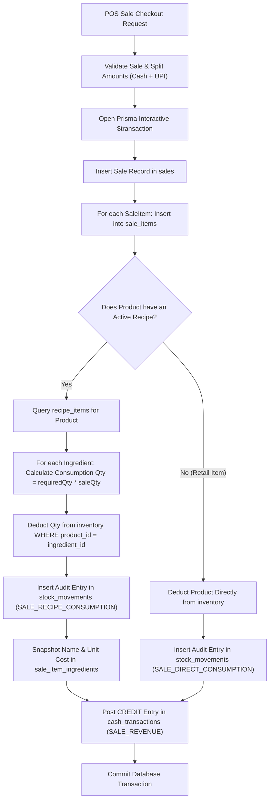
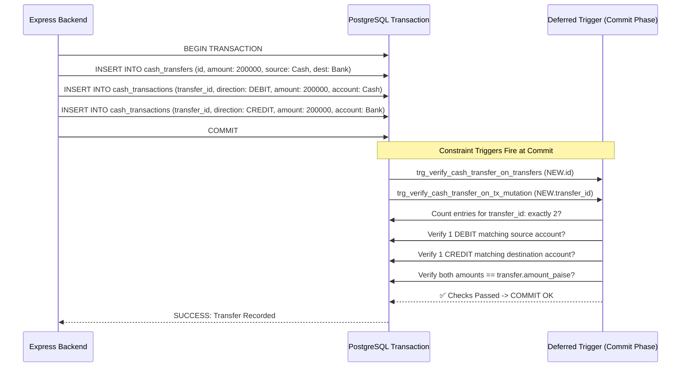
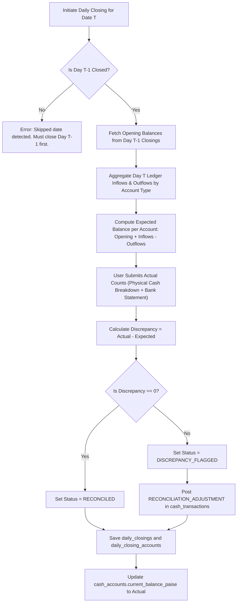

# 🌊 Nutrients Ocean – System Architecture & Technical Design Document
## Finance Management Dashboard V1

---

## 1. Architecture Overview & High-Level Topology

The **Nutrients Ocean Finance Management Dashboard V1** is structured as an audit-grade, decoupled client-server web application backed by a relational database engine. The system delivers sub-100ms financial transaction processing, real-time recipe-based ingredient depletion, double-entry cash ledger accounting, and strict multi-tenant data isolation.

```
┌────────────────────────────────────────────────────────────────────────┐
│                        FRONTEND CLIENT (Admin/)                        │
│             React 18 + Vite + Tailwind CSS + Lucide Icons              │
│       (POS Terminal, Recipe Margin Analyzer, Daily Closing Wizard)      │
└────────────────────────────────────┬───────────────────────────────────┘
                                     │ HTTPS / JSON REST
                                     ▼
┌────────────────────────────────────────────────────────────────────────┐
│                        BACKEND API (Server/)                           │
│                 Node.js 20+ LTS + Express + Prisma ORM                 │
│  ┌───────────────────────┐  ┌─────────────────┐  ┌──────────────────┐  │
│  │ Authentication & RBAC │  │  Sales Service  │  │ Inventory Service│  │
│  └───────────────────────┘  └─────────────────┘  └──────────────────┘  │
│  ┌───────────────────────┐  ┌─────────────────┐  ┌──────────────────┐  │
│  │   Refund Engine       │  │  Closing Service│  │  Cash Ledger Svc │  │
│  └───────────────────────┘  └─────────────────┘  └──────────────────┘  │
└────────────────────────────────────┬───────────────────────────────────┘
                                     │ Prisma Client (Prepared Statements)
                                     ▼
┌────────────────────────────────────────────────────────────────────────┐
│                      POSTGRESQL 15+ DATABASE                           │
│  - 23 Normalized Tables with Composite Foreign Keys                   │
│  - Integer Paise (BIGINT) Precision & Decimal(14,4) Metric Units      │
│  - Deferred Constraint Triggers: Pair Transfer Balance Verification   │
│  - Row-Level Business Isolation Triggers & Audit Logging Engine       │
└────────────────────────────────────────────────────────────────────────┘
```

---

## 2. Technology Stack & Key Architectural Decisions

| Layer | Technology | Version | Justification |
| :--- | :--- | :--- | :--- |
| **Frontend Framework** | React + Vite | 18.x / 5.x | Ultra-fast HMR, component modularity, high rendering performance for real-time POS and cash counters. |
| **Styling & UI Components** | Tailwind CSS + Lucide React | 3.4.x | Clean, utility-first UI without heavy external UI dependencies; responsive tables and modal wizards. |
| **Backend Runtime** | Node.js (LTS) | 20.x+ | Event-driven, asynchronous I/O with high concurrency throughput for simultaneous POS and stock operations. |
| **API Framework** | Express.js | 4.x / 5.x | Battle-tested, minimal overhead, unopinionated middleware routing, standardized request lifecycle. |
| **ORM & Query Builder** | Prisma ORM | 6.4.x | Type-safe schema definition, compile-time query validation, automated migrations, interactive `$transaction` support. |
| **Database Engine** | PostgreSQL | 15+ | ACID compliance, strict transactional DDL, deferred constraint triggers, composite foreign keys, JSONB audit logging. |
| **Validation Layer** | Zod | 3.22+ | Runtime schema validation for all API inputs before reaching services or database queries. |
| **Auth & Security** | JWT + bcrypt | 9.x / 5.x | Stateless authentication with signed tokens and secure salted password hashes. |

---

## 3. Database Architecture & Schema Design

### 3.1 Domain Model Structure (23 Normalized Tables)
The relational schema replaces all legacy MongoDB collections with normalized tables:

```
[businesses] ─────────┬──► [admins]
                      ├──► [members] ───────────┬──► [investments] ──► [cash_transactions]
                      │                         └──► [withdrawals] ──► [cash_transactions]
                      ├──► [cash_accounts] ─────┬──► [cash_transfers] ──► [cash_transactions]
                      │                         └──► [cash_transactions]
                      ├──► [products] ──────────┬──► [recipes] ──► [recipe_items]
                      │                         ├──► [inventory]
                      │                         └──► [stock_movements]
                      ├──► [purchases] ─────────┬──► [purchase_items] ──► [stock_movements]
                      │                         └──► [payments] ──► [cash_transactions]
                      ├──► [expenses] ──────────┴──► [payments] ──► [cash_transactions]
                      ├──► [sales] ─────────────┬──► [sale_items] ──► [sale_item_ingredients]
                      │                         │                 └──► [stock_movements]
                      │                         ├──► [refunds] ──► [refund_items] ──► [stock_movements]
                      │                         └──► [cash_transactions]
                      ├──► [daily_closings] ────┬──► [daily_closing_accounts]
                      │                         └──► [cash_transactions (Reconciliation Adjustments)]
                      └──► [audit_logs]
```

### 3.2 Multi-Tenant Business Isolation Pattern
Even within a single-company deployment, data integrity is guaranteed through database-level isolation:
1. **Composite Foreign Keys:** Child tables link to parent tables via `(business_id, parent_id)`. For example, `sale_items` references `sales(business_id, id)`.
2. **Optional Relation Isolation Trigger:** Optional relations in `cash_transactions` (such as `sale_id`, `payment_id`, `refund_id`, `transfer_id`) are protected by `fn_enforce_cash_tx_business_isolation()`, which verifies at database level that the referenced entity belongs strictly to `NEW.business_id`.
3. **No Cross-Business Contamination:** Direct database-level errors are thrown if any foreign key points to a record in another business tenant.

### 3.3 Numeric & Monetary Precision Standards
- **Monetary Storage:** All prices, costs, totals, discounts, taxes, and balances are stored as `BIGINT` in **integer paise** ($\text{₹}1.00 = 100\text{ paise}$).
- **Inventory Quantities:** All inventory on hand, recipe quantities, purchase receipts, and sales deductions are stored as `Decimal(14, 4)` to support fine-grained metric units ($0.0001\text{ g}$ or $0.0001\text{ ml}$).

---

## 4. Key Computational & Transactional Workflows

### 4.1 Workflow 1: Recipe-Based Stock Consumption on Sale
When a customer orders a finished product (e.g., "Protein Smoothie"), the system does not deplete finished goods; it executes an atomic bill-of-materials explosion.



#### Step-by-Step Execution:
1. **Recipe Lookup:** Queries `recipes` join `recipe_items` for each finished `productId`.
2. **Quantity Consumption Formula:**
   $$\text{Quantity To Deduct} = \frac{\text{Recipe Item Quantity Required}}{\text{Recipe Yield Quantity}} \times \text{Sold Quantity}$$
3. **Unit Consistency Validation:** Enforces that `recipe_items.measurement_unit` matches `inventory.unit`. If mismatched, the transaction is rejected.
4. **Moving Average Cost (MAC) Valuation:** The system takes the current `average_unit_cost_paise` from `inventory` and snapshots it in `sale_item_ingredients.unit_cost_paise`. Total line COGS is computed:
   $$\text{Ingredient Total Cost Paise} = \lceil \text{Quantity To Deduct} \times \text{average\_unit\_cost\_paise} \rceil$$
5. **Inventory Update:** Reduces `inventory.quantity_on_hand` and `inventory.total_valuation_paise`.

---

### 4.2 Workflow 2: Deterministic Partial Refund Allocation (Hamilton-Hare Method)
When a customer returns one or more items from a multi-item bill containing header-level discounts or taxes, standard fractional calculations cause rounding drift. Nutrients Ocean implements the **Hamilton-Hare Largest Remainder Method**.

#### Step-by-Step Algorithm:
1. **Cumulative Boundary Check:** Queries existing `refund_items` for each `sale_item_id` inside a row-locked transaction (`FOR UPDATE`):
   $$\text{Remaining Qty} = \text{sale\_items.quantity} - \sum \text{previous\_refund\_items.quantity\_refunded}$$
   $$\text{Remaining Value} = \text{sale\_items.subtotal\_paise} - \sum \text{previous\_refund\_items.refund\_amount\_paise}$$
   Rejects request immediately if $\text{Requested Qty} > \text{Remaining Qty}$.
2. **Gross Refund Allocation:**
   $$\text{Gross Refund}_i = \text{Requested Qty}_i \times \text{sale\_items.unit\_price\_paise}_i$$
3. **Proportional Discount & Tax Share:**
   For a bill with header discount $D$ and tax $T$ on subtotal $S$:
   $$\text{Target Refund}_i = \text{Gross Refund}_i \times \frac{S - D + T}{S}$$
4. **Largest Remainder Rounding:**
   - Compute integer floor: $\lfloor \text{Target Refund}_i \rfloor$.
   - Calculate fractional remainder: $r_i = \text{Target Refund}_i - \lfloor \text{Target Refund}_i \rfloor$.
   - Compute remaining discrepancy paise:
     $$\Delta = (S_{\text{refunded}} - D_{\text{refunded}} + T_{\text{refunded}}) - \sum \lfloor \text{Target Refund}_i \rfloor$$
   - Distribute $+1$ paisa to the items sorted in descending order of remainder $r_i$ until $\Delta = 0$.
5. **Inventory Restock Policy:** If `restockInventory = true`, increases `inventory.quantity_on_hand` and logs `stock_movements` with `REFUND_RESTOCK`.
6. **Ledger Reversal:** Posts `DEBIT` entry in `cash_transactions` (`CUSTOMER_REFUND`).

---

### 4.3 Workflow 3: Atomic Internal Cash Transfers with Deferred Verification
Transferring funds between the cash drawer, UPI account, and bank current account requires a paired, balanced double-entry ledger update.

#### Deferred Constraint Trigger Architecture:
In PostgreSQL, standard row triggers fire per row. During an atomic transfer, inserting the first leg (DEBIT) temporarily leaves the ledger unbalanced until the second leg (CREDIT) is inserted. Nutrients Ocean resolves this with **`DEFERRABLE INITIALLY DEFERRED`** constraint triggers.



#### Enforced Invariants:
1. Source and destination accounts must be distinct:
   ```sql
   CONSTRAINT chk_cash_transfers_different_accounts CHECK (source_cash_account_id <> destination_cash_account_id)
   ```
2. One transfer cannot have duplicate legs in the same direction:
   ```sql
   CONSTRAINT uq_cash_tx_transfer_direction UNIQUE (transfer_id, direction)
   ```
3. Any single-leg deletion or modification fails at transaction commit:
   `fn_verify_cash_transfer_balance()` validates both `OLD.transfer_id` and `NEW.transfer_id`.

---

### 4.4 Workflow 4: Sequential Daily Closing & Multi-Account Reconciliation
Daily closing ensures that the physical till, UPI gateway receipts, and bank balances reconcile with the digital ledger every single business day.



#### Opening Balance Chaining Guarantee:
$$\text{Opening Balance}(A, T) = \text{Actual Balance}(A, T-1)$$
If closing for the first business day (`2026-11-10`), the opening balance defaults to `cash_accounts.opening_balance_paise`.

---

## 5. Backend Architecture & Service Layer Structure

The `Server/` codebase follows a clean layered design separating HTTP transport, business orchestration, and database access:

```
Server/
├── prisma/
│   ├── schema.prisma              # 23-model relational schema
│   └── migrations/                # Versioned SQL migrations & triggers
├── src/
│   ├── config/
│   │   ├── env.js                 # Typed environment variables
│   │   └── database.js            # Prisma client singleton
│   ├── constants/
│   │   ├── enums.js               # Enums mirroring PostgreSQL DDL
│   │   └── business.js            # Nutrients Ocean defaults (Start date, INR)
│   ├── middlewares/
│   │   ├── auth.middleware.js      # JWT verification & RBAC guard
│   │   ├── business.middleware.js  # Multi-tenant business context binder
│   │   ├── validate.middleware.js  # Zod schema validation
│   │   └── error.middleware.js     # Centralized error handler
│   ├── controllers/
│   │   ├── auth.controller.js
│   │   ├── sales.controller.js
│   │   ├── recipes.controller.js
│   │   ├── inventory.controller.js
│   │   ├── cash.controller.js
│   │   ├── closings.controller.js
│   │   └── reports.controller.js
│   ├── services/
│   │   ├── sales.service.js       # POS sale orchestration & recipe deductions
│   │   ├── refund.service.js      # Hamilton-Hare allocation & restock
│   │   ├── inventory.service.js   # MAC cost recalculation & movements
│   │   ├── transfer.service.js    # Paired internal transfers
│   │   ├── closing.service.js     # Sequential closing & reconciliation
│   │   └── report.service.js      # Financial P&L and margin queries
│   ├── utils/
│   │   ├── currency.js            # Integer paise formatting & math
│   │   ├── hamilton-hare.js       # Largest remainder rounding engine
│   │   └── response.js            # Standardized API response formatters
│   └── server.js                  # Express app bootstrap & route mounting
```

### 5.1 Interactive Transaction Boundary Standard
All mutative financial workflows must run within `prisma.$transaction(async (tx) => { ... }, { isolationLevel: 'Serializable' })` to guarantee consistency under high-frequency POS requests.

### 5.2 Centralized Error Hierarchy
```javascript
class AppError extends Error {
  constructor(message, statusCode, errorCode, details = null) {
    super(message);
    this.statusCode = statusCode;
    this.errorCode = errorCode;
    this.details = details;
  }
}
```

---

## 6. Frontend Architecture & User Interface Design

The `Admin/` client provides a responsive, single-page application built with React and Vite. It is strictly focused on Nutrients Ocean food operations with **zero task-planner or PlanPro elements**.

### 6.1 Core Screen Layouts
1. **Executive Financial Summary (Home / Dashboard):**
   - KPI Stat Cards: Today's Gross Revenue (₹), Net Profit (₹), Cash Drawer Balance (₹), Active UPI Balance (₹), Low Stock Alerts Count.
   - Quick Action Bar: "New POS Sale", "Record Expense", "Transfer Funds", "Start Daily Closing".
   - Recent Transactions Stream: Real-time ledger entries with status badges.
2. **POS Counter Terminal (`/sales/pos`):**
   - Product Grid: Filterable by category (Smoothies, Protein Bowls, Meals, Supplements).
   - Order Cart: Dynamic line item quantities, line discount input, bill discount.
   - Payment Split Modal: Direct inputs for Cash and UPI amounts with auto-balance calculation.
3. **Recipe & Ingredient Studio (`/recipes`):**
   - Bill of Materials editor: Multi-ingredient selector with yield definition and live BOM cost calculation.
   - Margin Simulator: Visual display of Profit Margin % based on selling price vs ingredient cost.
4. **Inventory & Stock Manager (`/inventory`):**
   - Live Stock Table: Quantity on hand, base unit (`g`, `ml`, `pcs`), Moving Average Cost, valuation.
   - Adjustment Dialog: Log wastage/spoilage or manual count corrections.
5. **Cash Drawer & Internal Transfer Hub (`/cash`):**
   - Account Cards: Physical Drawer, PhonePe Merchant UPI, HDFC Bank Current.
   - Transfer Modal: Two-account selector with automatic paired ledger verification.
6. **Sequential Daily Closing Wizard (`/closings`):**
   - Day Validation Step: Confirms previous day closing status.
   - Denomination Calculator: Detailed cash note breakdown (₹500, ₹200, ₹100, ₹50, ₹20, ₹10, Coins).
   - Reconciliation Diff View: Shows Expected vs Actual with discrepancy warning.
7. **Partner Equity & Reinvestment Ledger (`/partners`):**
   - Capital accounts for the 3 founding partners, profit distribution history, and earmarked reinvestment funds.

---

## 7. Security, Auditing & Anti-Tamper Matrix

| Component | Threat / Risk | Mitigating Architecture |
| :--- | :--- | :--- |
| **Cash Ledger** | Unauthorized record modification or deletion. | PostgreSQL triggers reject direct UPDATE/DELETE without offsetting reversal transactions. |
| **Cross-Tenant Access** | Leaking financial data to another business ID. | Database composite foreign keys + `fn_enforce_cash_tx_business_isolation()` trigger. |
| **Rounding Leakage** | 1-paisa drift accumulating over thousands of sales. | Strict integer paise (`BIGINT`) + Hamilton-Hare Largest Remainder rounding. |
| **Negative Cash Drawer** | Cashier recording more cash refunds than available in till. | API check + trigger verifying account balance before processing cash disbursements. |
| **Concurrent Refunds** | Double-refunding an item in two open browser tabs. | Database row-level locks (`SELECT ... FOR UPDATE`) inside the Prisma transaction. |
| **Skipped Day Closing** | Attempting to close today without reconciling yesterday. | Unique index `(business_id, closing_date)` + pre-closing verification check. |
